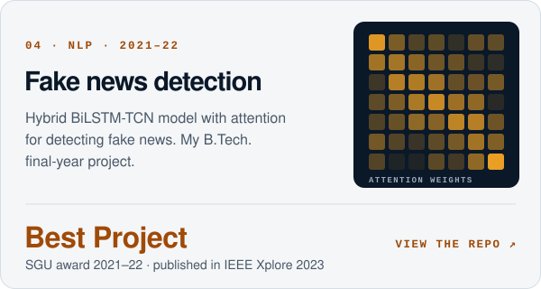
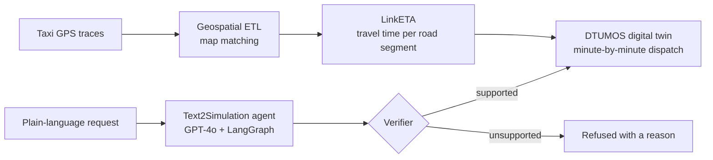

<picture>
  <source media="(prefers-color-scheme: dark)" srcset="assets/banner-dark.svg">
  
</picture>

I'm a machine learning researcher at the SPIN Lab, Wilfrid Laurier University. I work on travel-time prediction and digital twins for urban mobility, from raw taxi GPS traces to systems people can use: a graph model that predicts travel time for every road segment, a taxi dispatch simulation I helped build, and an LLM agent that sets up simulations from plain language.

Looking for machine learning and research roles in Canada · [LinkedIn](https://linkedin.com/in/mubaraks)

### Featured work

  <a href="https://papers.ssrn.com/sol3/papers.cfm?abstract_id=7379984"><picture><source media="(prefers-color-scheme: dark)" srcset="assets/card-linketa-dark.svg"></picture></a>
  <picture><source media="(prefers-color-scheme: dark)" srcset="assets/card-text2simulation-dark.svg"></picture>

  <a href="https://github.com/mubarak-exe/DTUMOS"><picture><source media="(prefers-color-scheme: dark)" srcset="assets/card-dtumos-dark.svg"></picture></a>
  <a href="https://github.com/mubarak-exe/Fake_News_Detection_Using_Hybrid_BiLSTM_TCN_Model_With_Attention_Mechanism"><picture><source media="(prefers-color-scheme: dark)" srcset="assets/card-fake-news-dark.svg"></picture></a>

<picture>
  <source media="(prefers-color-scheme: dark)" srcset="assets/toolkit-dark.svg">
  
</picture>

<b>How I work</b> · five rules, each with the result behind it

 

1. **Start with the raw trace.** A model inherits every flaw in its data, so I clean and structure data myself. For LinkETA, a geospatial ETL pipeline turned raw taxi GPS trips into 8M+ road-segment data points.
2. **Compare against the strongest baseline.** On average, LinkETA had 23.7% lower error than Baidu's DuETA and 17.6% lower than Uber's DeeprETA.
3. **Design for the city with no data.** With only 25 trips per new city, my meta-learning method cut road-segment error by up to 14.2%.
4. **Put the model inside a system.** LinkETA supplies traffic-aware travel times inside the DTUMOS digital twin, which runs in 1-minute steps.
5. **Check before you trust.** Text2Simulation's verifier caught 96.7% of unsupported requests with zero false alarms.

<b>How my projects connect</b> · diagram

 

<b>Publications and awards</b>

 

- [Intelligent Digital Twin System for Urban Mobility](https://scholars.wlu.ca/etd/2908/). Master's thesis, Wilfrid Laurier University, 2026.
- [LinkETA: A Multi-Relational Graph Transformer for Link-Level Travel Time Estimation](https://papers.ssrn.com/sol3/papers.cfm?abstract_id=7379984). Preprint, SSRN.
- Link-Level Spatio-Temporal Travel Time Prediction for Multi-Modal Commute Trip Estimation. IEEE Xplore.
- Text2Simulation: A Natural Language Interface for Transportation Digital Twin Systems. IEEE Xplore.
- [Fake News Detection Using Hybrid BiLSTM-TCN Model with Attention Mechanism](https://ieeexplore.ieee.org/document/10140491). IEEE Xplore, 2023.

Award for Outstanding Graduate Work, Wilfrid Laurier University, Class of 2026 · $54K CAD in graduate funding and studentship · SGU Best Project Award, 2021–22

<b>Full toolkit</b>

 

- **Machine learning:** Python, R, Transformers, GNN, CNN, LSTM, NLP, DQN, LLMs, spatiotemporal prediction, meta-learning, reinforcement learning, recommendation systems, clustering, LangChain, LangGraph
- **Maps and geospatial:** OSRM, OpenStreetMap, map matching, OR-Tools, GeoPandas, Shapely, Folium, simulation
- **Libraries:** NumPy, Pandas, SciPy, scikit-learn, PyTorch, TensorFlow, Keras, PyG, Matplotlib, Seaborn
- **Data and engineering:** SQL (MySQL), MongoDB, Hadoop, CUDA, Airflow, Git, AWS, Docker, Jira, Agile, PRISMA reviews, unit testing, QA testing

