# Mubarak Shikalgar

Machine learning researcher · specializing in transportation and urban mobility 
[LinkedIn](https://linkedin.com/in/mubaraks) · [Master's thesis](https://scholars.wlu.ca/etd/2908/) · [LinkETA preprint](https://papers.ssrn.com/sol3/papers.cfm?abstract_id=7379984)

## About

<picture>
  <source media="(prefers-color-scheme: dark)" srcset="assets/map-dark.svg">
  
</picture>

I'm a machine learning researcher in Waterloo, Ontario. I design and train models for complex, real-world data such as graphs, time series, text and multimodal signals. My work covers:

- Deep learning: Transformers, GNNs, LSTMs, CNNs (PyTorch, TensorFlow)
- Graph ML: spatiotemporal forecasting on graphs
- LLM agents and NLP: LangGraph, LangChain, agent output verification
- Few-shot learning: meta-learning with MAML and Reptile
- Optimization: mixed-integer programming, genetic algorithms, Google OR-Tools
- Big data: large-scale and geospatial ETL, Hadoop, Airflow

My specialty is transportation and urban mobility. At the SPIN Lab, Wilfrid Laurier University, I research travel-time estimation, spatiotemporal modelling of road networks, and digital twins that simulate how a city moves. I've also applied machine learning to NLP, affective computing and computer vision, and I spent two years as an IT consultant in Mumbai leading web product development. I hold a Master of Applied Computing from Wilfrid Laurier University.

Currently looking for machine learning and research roles in Canada.

## Experience

**Research**
- [SPIN Lab](https://www.linkedin.com/company/spin-lab-wlu/posts/), Wilfrid Laurier University · **Research Assistant** · Jan 2025 – present
  - [LinkETA](https://papers.ssrn.com/sol3/papers.cfm?abstract_id=7379984) (travel-time estimation)
  - MetaETA (meta-learning for travel-time estimation in cities with no data)
  - Multimodal ETA (travel-time estimation for multi-modal commute trips)
  - [DTUMOS](https://github.com/mubarak-exe/DTUMOS) (digital twin for urban mobility)
  - Text2Simulation (LLM agent for digital-twin simulations)
  - Affect recognition by socially assistive robots (systematic PRISMA review, with SQUAD Lab)

**Teaching**
- Wilfrid Laurier University · **Graduate Teaching Assistant**
  - [CP421: Data Mining](https://academic-calendar.wlu.ca/course.php?c=72574&cal=1&d=2948&s=1118&y=90) · Fall 2025, Winter 2026
  - [CP476: Internet Computing](https://academic-calendar.wlu.ca/course.php?c=63922&cal=1&d=2576&s=1034&y=85) · Winter 2025, Spring 2025

**Industry**
- Glazingshopee, Mumbai · **IT Consultant** · Jun 2022 – Jun 2024
  - Products: [FacadeMart](https://www.facademart.com/) · Buyglass24 · EdFacade
- [Sharp Electronics](https://www.sharpelectronics.net/), Pune · **Intern** · Jan 2021 – Feb 2021

## Education

- **[Master of Applied Computing](https://www.wlu.ca/programs/science/graduate/applied-computing-mac/index.html)**, Wilfrid Laurier University · 2024 – 2026
  - Thesis: [Intelligent Digital Twin System for Urban Mobility](https://scholars.wlu.ca/etd/2908/)
  - Supervisor: [Dr. Sukhjit Singh Sehra](https://www.wlu.ca/academics/faculties/faculty-of-science/faculty-profiles/sukhjit-sehra/index.html) · Co-supervisor: Dr. Emad A. Mohammed
- **B.Tech. in Computer Science and Engineering**, Sanjay Ghodawat University · 2018 – 2022
  - Final-year project: [Fake News Detection using Hybrid BiLSTM-TCN Model with Attention Mechanism](https://github.com/mubarak-exe/Fake_News_Detection_Using_Hybrid_BiLSTM_TCN_Model_With_Attention_Mechanism)

## Honors and awards

- Award for Outstanding Graduate Work, Wilfrid Laurier University · 2026
- Graduate Studentship, Wilfrid Laurier University · 2025–2026
- Graduate Student Guaranteed Funding, Wilfrid Laurier University · 2025–2026
- SGU Best Project Award, Sanjay Ghodawat University · 2021–2022

## Tech stack

**Languages** · Python and Java link to my NPTEL certificates 
  

**Machine learning and LLMs** 
       

**Maps and geospatial** 
  

**Big data and engineering** 
       

## Professional affiliations

- Member, Canadian Artificial Intelligence Association (CAIAC) · 2026 – present
- Member, ML Collective (MLC) · 2026 – present

## Publications

- [Intelligent Digital Twin System for Urban Mobility](https://scholars.wlu.ca/etd/2908/)
- [LinkETA: A Multi-Relational Graph Transformer for Link-Level Travel Time Estimation](https://papers.ssrn.com/sol3/papers.cfm?abstract_id=7379984)
- Link-Level Spatio-Temporal Travel Time Prediction for Multi-Modal Commute Trip Estimation (IEEE WF-IoT 2026)
- Text2Simulation: A Natural Language Interface for Transportation Digital Twin Systems (IEEE GESS 2026)
- Affect Recognition in Socially Assistive Robots for Dementia Care: A Systematic Review (under review)
- [Fake News Detection using Hybrid BiLSTM-TCN Model with Attention Mechanism](https://ieeexplore.ieee.org/document/10140491)

## Quick links

  
